## Papel e objetivo

Você é o diretor de arte da BuildV produzindo **6 criativos estáticos para Meta Ads** (Facebook e
Instagram) do cliente **Ápice Arquitetura e Engenharia** — empresa de Porto Alegre/RS que executa
reformas e ampliações comerciais e industriais em regime turnkey, com atuação recorrente dentro de
indústrias como Ambev e WEG.

Gere **cada um dos 6 criativos em 3 formatos** (1:1 · 4:5 · 9:16) = **18 artboards**, em
**HTML + CSS inline**, com **1080px de largura** de canvas, prontos para exportar em **PNG @2x**.
Não gere vídeo, não gere carrossel, não invente textos: use exatamente os títulos e subtítulos do
briefing abaixo.

## Fontes de verdade (nesta ordem de prioridade)

1. `design-system/criativos-meta-ads.md` + `criativos-meta-ads.css` — módulo de criativos do design
   system. **Use as classes e tokens dele; não crie cores, fontes ou raios novos.**
2. Este briefing (seção "Os 6 criativos").
3. Diretrizes obrigatórias: WCAG 2.0 (contraste 1.4.3 ≥ 4,5:1; cor não é único canal 1.4.1),
   Heurísticas de Nielsen (#4 consistência, #6 reconhecimento, #8 minimalismo) e boas práticas
   Meta Ads (visual primeiro, texto mínimo, CTA de alto contraste, safe zones).

## Identidade — resumo do que você deve respeitar

- **Cores:** ink `#121212` · graphite `#272727` · gray `#adacad` · gray-light `#d5d5d6` ·
  **bronze `#ce9e70` (acento)** · sand `#d0b093` · sand-pale `#e7d0ba` · paper `#fafafa` ·
  bronze-ink `#8a6a44` (bronze legível sobre claro).
- **Fontes (Google Fonts):** Jost 500 para títulos (caixa alta), Barlow 400/600 para subtítulo,
  bullets e CTA. Wordmark é imagem (PNG do logo), nunca texto.
- **Forma:** raio 2px em tudo; filete bronze de 4px como elemento de acento; molduras geométricas
  retas; pattern diagonal a ≤ 8% de opacidade só onde não há texto.
- **Fotos:** sempre reais (as anexadas), `saturate(.75–.85) contrast(1.05–1.12)`. Nunca banco de
  imagens, nunca ilustração, nunca IA.
- **Tom:** técnico, controlado, industrial. Sensação de engenharia, não de propaganda.

## Regras não negociáveis (verifique cada artboard antes de fechar)

1. **Safe zones Meta.** Texto, CTA e logo só dentro da área útil:
   1:1 → 100px de todas as bordas · 4:5 → 250px topo/base, 100px laterais ·
   9:16 → 269px topo, 672px base (768px no canto inferior direito), 65px laterais, e a coluna
   direita de 120px na metade inferior fica livre para os ícones de engajamento.
   A foto pode sangrar até a borda; o texto não.
2. **Contraste WCAG.** Todo texto ≥ 4,5:1 contra o fundo real; título ≥ 7:1 sempre que possível.
   Texto **nunca** direto sobre a foto: use bloco sólido `#121212`, scrim (92%→55%) ou tint 70%.
   Pares permitidos e proibidos estão na seção 3 do módulo. Em especial: **CTA = fundo bronze +
   texto ink** (7,8:1). Nunca texto branco sobre bronze, nunca bronze sobre claro.
3. **Hierarquia mínima (Nielsen #8).** 1 eyebrow (opcional) + 1 título + 1 subtítulo + até 3
   bullets (só em 4:5 e 9:16) + 1 CTA + logo. Nada mais. A legenda do briefing **não vai na
   imagem** — é o texto do anúncio.
4. **Texto mínimo e legível no celular.** Título 84px (96px no 9:16), máx. 3 linhas; subtítulo
   34px, máx. 2 linhas; nada abaixo de 22px. Área com texto ≤ 20% do canvas.
5. **CTA de alto contraste, único, em forma de botão** (`.ad-cta`), altura ≥ 88px, verbo no
   imperativo, ≤ 4 palavras.
6. **Consistência entre as 6 peças (Nielsen #4).** Mesmo botão, mesma posição relativa do logo
   dentro de cada arquétipo, mesma escala tipográfica. Quem vê as 6 no feed reconhece a mesma marca.
7. **Cor não é o único canal (WCAG 1.4.1).** Bullets com `✔`, etapas com número, CTA com forma
   de botão e seta.
8. **Logo.** `apice-horizontal-branco.png` sobre fundo escuro; `apice-horizontal-chumbo.png` sobre
   claro; `apice-simbolo-*.png` quando o espaço for pequeno. Largura 240px (300px no 9:16). Se a
   foto já tiver a marca d'água "ÁPICE" no canto inferior esquerdo (fotos de auditório/sala Ambev
   Pelotas), coloque o logo no lado oposto.
9. **Sem texto na foto além do que já existe nela.** Placas reais (ex.: "ambev", "CDD Santa Cruz")
   podem aparecer — são prova. Não recorte nem desfoque o nome do cliente nas peças do case.
10. **Um único CTA visual por peça**; sem preços, sem "clique aqui", sem emojis, sem urgência falsa.

## Estrutura HTML esperada por artboard

```html
<div class="ad ad--portrait" data-creative="01-autoridade" data-format="4:5">
  <!-- camada de foto (pode sangrar) -->
  <!-- camada de bloco/scrim -->
  <div class="ad-safe">
    <div class="ad-eyebrow">…</div>
    <h1 class="ad-headline">…</h1>
    <p class="ad-sub">…</p>
    <ul class="ad-bullets">…</ul>          <!-- opcional -->
    <a class="ad-cta mt-auto">…</a>
  </div>
  
</div>
```

Use `.ad--square` (1080×1080), `.ad--portrait` (1080×1350) e `.ad--story` (1080×1920). Todos os
estilos vêm do `criativos-meta-ads.css`; ajustes finos podem ser inline, mas sem novos valores de
cor/fonte/raio. Nomeie os artboards `apice_{n}-{arquetipo}_{1x1|4x5|9x16}`.

---

## Os 6 criativos

Para cada um: arquétipo do módulo, imagens designadas (arquivo exato na pasta `imagens/`), texto
fixo e CTA. As imagens "alt" são alternativas se a principal não render bem no recorte.

### 1 · Autoridade — segurança industrial · Arquétipo **A (Split grid)**
- **Objetivo:** reconhecimento e confiança entre gestores industriais; segurança como padrão operacional.
- **Imagem principal:** `01-autoridade/01-autoridade_principal-equipe-concretagem-industria.jpg`
  (equipe com EPI concretando dentro de indústria em operação, caminhão-betoneira e tanque ao fundo).
  Alternativas: `…_alt-plataforma-fachada-ambev.jpg`, `…_alt-corte-piso-industrial.jpg`.
- **Layout:** grid dividido — a foto ocupa ~58% (em cima no 4:5/9:16; à esquerda no 1:1) com
  `saturate(.75)` e moldura geométrica `.ad-frame--corners` em bronze; o bloco `#121212` ocupa o
  restante e carrega todo o texto e o logo. Sensação de controle, não de improviso.
- **Eyebrow:** SEGURANÇA INDUSTRIAL
- **Título:** OBRA SEGURA DENTRO DA SUA INDÚSTRIA
- **Subtítulo:** Equipe preparada para operar dentro da sua indústria
- **Bullets (só 4:5 e 9:16):** Equipe calejada em ambiente industrial · Execução sem interromper a operação · Documentação e liberações em dia
- **CTA:** Solicite um diagnóstico
- **Logo:** horizontal branco, canto inferior direito do bloco ink.

### 2 · Dor — aditivo surpresa · Arquétipo **B (Document card)**
- **Objetivo:** leads de gestores cansados de orçamento que muda no meio da obra.
- **Imagem de fundo:** `02-dor-aditivo/02-dor-aditivo_principal-nivel-laser-canteiro.jpg`
  (nível a laser em tripé no canteiro — instrumento de precisão, ideia de controle), desfocada
  `blur(6px)` + tint 70%. Alternativas: `…_alt-canteiro-plataforma-elevatoria.jpg`, `…_alt-contencao-patio.jpg`.
- **Layout:** foto full-bleed desfocada; `.ad-doc` centralizado (card claro simulando contrato:
  4 linhas neutras, 1 linha destacada em sand-pale com o texto "VALOR E PRAZO FECHADOS", carimbo
  girado "EM CONTRATO"); título e subtítulo abaixo do card em paper/gray; CTA bronze. Paleta neutra,
  o **bronze aparece só no CTA e no carimbo**. Atmosfera de tensão controlada: o problema existe, há solução.
- **Eyebrow:** (sem eyebrow — o card já é o gancho)
- **Título:** ADICIONAL NO MEIO DA OBRA?
- **Subtítulo:** Prazo e valor fechados em contrato, sem surpresa
- **Bullets (só 4:5 e 9:16):** Valor definido em contrato · Sem cobrança fora do escopo combinado · Previsibilidade do início ao fim
- **CTA:** Fale com um especialista
- **Logo:** símbolo branco 120px, discreto, canto superior direito.

### 3 · Solução completa — turnkey · Arquétipo **C (Stack de etapas)**
- **Objetivo:** leads de decisores que hoje coordenam múltiplos fornecedores.
- **Imagens (3, nesta ordem):**
  1. Base → `03-turnkey/03-turnkey_etapa1-base-armadura.jpg` (armadura de aço sobre lastro)
  2. Estrutura → `03-turnkey/03-turnkey_etapa2-estrutura-galpao-metalico.jpg` (galpão metálico com concretagem)
  3. Acabamento → `03-turnkey/03-turnkey_etapa3-acabamento-escritorio-ambev.jpg` (escritório entregue)
  Alternativas: `…_alt-etapa1-base-forma.jpg`, `…_alt-etapa2-estrutura-metalica.jpg`, `…_alt-etapa3-acabamento-auditorio-ambev.jpg`.
- **Layout:** três fotos recortadas em blocos retangulares **colados, sem gap** (lado a lado no
  1:1 e 4:5; empilhadas no 9:16), cada uma com legenda `.ad-caption` "01 BASE" · "02 ESTRUTURA" ·
  "03 ACABAMENTO"; unidas por barra bronze de 24px com o **símbolo chumbo centralizado**. Bloco
  ink abaixo (ou ao lado) com o texto. Tipografia técnica, alinhamento rígido. Sensação de
  processo único, não fragmentado.
- **Eyebrow:** BASE · ESTRUTURA · ACABAMENTO
- **Título:** OBRA COMPLETA, UM SÓ RESPONSÁVEL
- **Subtítulo:** Estrutura, piso, elétrica e acabamento sem terceirizar a gestão
- **Bullets (só 4:5 e 9:16):** Escopo turnkey completo · Um único responsável técnico · Atuação em indústria, comércio e corporativo
- **CTA:** Receba o estudo de viabilidade
- **Logo:** horizontal branco no bloco ink, canto inferior direito.

### 4 · Portfólio — case Ambev · Arquétipo **D (Case / Prova)**
- **Objetivo:** reduzir objeção de credibilidade com obra real entregue para grande indústria.
- **Imagem principal:** `04-case-ambev/04-case-ambev_principal-fachada-cdd-santa-cruz-obra.jpg`
  (fachada do CDD Santa Cruz com a placa "ambev" e técnico em plataforma elevatória — obra real em
  andamento). Secundárias, para o 9:16 ou como recorte menor em moldura: `…_sec-auditorio-cdd-pelotas-entregue.jpg`,
  `…_sec-lounge-ambev-santa-cruz-entregue.jpg`. Alternativa: `…_alt-estrutura-metalica-piso.jpg`.
- **Layout:** foto ocupa o quadro com scrim na base; `.ad-client-tag` no topo da área útil:
  "CLIENTE · AMBEV · CDD SANTA CRUZ"; título e subtítulo sobre o scrim; `.ad-brandbar` sólida na
  base com "OBRA TURNKEY ENTREGUE" à esquerda e logo à direita. No 9:16, use a foto principal em
  cima e a foto do auditório entregue (Pelotas) em moldura menor abaixo do título, como
  "antes/depois" implícito. Tom de comprovação, não de propaganda. **Não esconda a placa da Ambev.**
- **Eyebrow:** (a client-tag faz o papel)
- **Título:** AMPLIAÇÃO ENTREGUE PARA A AMBEV
- **Subtítulo:** Estrutura metálica, piso e comunicação visual em obra turnkey
- **Bullets (só 4:5 e 9:16):** Obra real entregue em ambiente industrial · Execução turnkey completa · Atuação recorrente em contas do setor industrial
- **CTA:** Solicite uma proposta
- **Logo:** horizontal branco na brandbar.

### 5 · Desejo — parceria de longo prazo · Arquétipo **E (Timeline)**
- **Objetivo:** decisores que buscam fornecedor para crescer junto ao longo de vários contratos.
- **Imagens (3 crescentes):**
  1. Obra pequena → `05-parceria/05-parceria_bloco1-pequena-reparo-pavimento.jpg` (reparo de pavimento, equipe)
  2. Obra média → `05-parceria/05-parceria_bloco2-media-reforma-escritorio.jpg` (reforma de escritório)
  3. Obra grande → `05-parceria/05-parceria_bloco3-grande-galpao-estrutura.jpg` (galpão metálico)
  Alternativas: `…_alt-bloco1-reparo.jpg`, `…_alt-bloco2-pavimentacao.jpg`, `…_alt-bloco3-estrutura.jpg`.
- **Layout:** fundo **claro `#fafafa`** (única peça clara do conjunto — variação dark permitida se
  o contraste com o feed pedir), `.ad-timeline` com três fotos em recorte quadrado de tamanhos
  crescentes (200 → 280 → 380px; no 9:16 a linha fica vertical), conectadas por linha fina bronze.
  Sob cada bloco, `.ad-caption` "1ª OBRA" · "CONTRATOS RECORRENTES" · "PARCERIA". Título em ink,
  subtítulo em `#5c5c5c`, eyebrow em bronze-ink. Muito espaço em branco. Sensação de progressão e
  confiança construída aos poucos.
- **Eyebrow:** DE R$ 20 MIL A R$ 4 MILHÕES COM O MESMO CLIENTE
- **Título:** PEQUENA OBRA VIROU PARCERIA DE MILHÕES
- **Subtítulo:** Confiança construída obra após obra dentro da sua indústria
- **Bullets (só 4:5 e 9:16):** Relação construída a partir de entregas reais · Capacidade comprovada antes de escalar o contrato · Foco em indústrias da região de Porto Alegre
- **CTA:** Converse com a Ápice
- **Logo:** horizontal **chumbo**, rodapé da área útil, à direita.

### 6 · Fundo de funil — direto · Arquétipo **F (Direto + Selo)**
- **Objetivo:** converter quem já pesquisa reforma comercial/industrial em Porto Alegre e região.
- **Imagem principal:** `06-fundo-funil/06-fundo-funil_principal-equipe-canteiro-industrial.jpg`
  (equipe em movimento concretando em canteiro industrial, plano aberto). Alternativas:
  `…_alt-equipe-descarga-galpao.jpg`, `…_alt-obra-plano-aberto.jpg`.
- **Layout:** foto plano aberto com `contrast(1.1)` para uniformizar, scrim escuro da esquerda
  para a direita e de baixo para cima; texto em coluna à esquerda; `.ad-seal` no canto superior
  direito da área útil: caption "RAIO DE ATUAÇÃO" + número "100 KM" + caption "PORTO ALEGRE".
  Direto, sem elementos decorativos (sem moldura, sem pattern). Comunica ação imediata.
- **Eyebrow:** REFORMA COMERCIAL OU INDUSTRIAL
- **Título:** PORTO ALEGRE E REGIÃO
  *(quebre o título do briefing "REFORMA COMERCIAL OU INDUSTRIAL, PORTO ALEGRE" em eyebrow + título
  para respeitar as 3 linhas; se preferir manter o título integral, use `.ad-headline--sm`)*
- **Subtítulo:** Atendimento em um raio de até 100km da capital
- **Bullets (só 4:5 e 9:16):** Atuação em Porto Alegre e região (até 100km) · Orçamento sem letras miúdas · Início rápido após aprovação do escopo
- **CTA:** Peça sua proposta em 24h
- **Logo:** horizontal branco, canto inferior direito da área útil (no 9:16 respeite a coluna de engajamento).

---

## Checklist final antes de exportar (rode em cada um dos 18 artboards)

- [ ] Título, subtítulo, bullets, CTA e logo **dentro da safe zone** do formato.
- [ ] Nenhum texto direto sobre foto sem bloco/scrim/tint; contraste ≥ 4,5:1 (título ≥ 7:1).
- [ ] CTA bronze `#ce9e70` + texto `#121212`, único, ≥ 88px, com seta.
- [ ] Máx. 3 linhas de título, 2 de subtítulo, 3 bullets (0 bullets no 1:1).
- [ ] Raio 2px em tudo; nenhuma cor fora da paleta; Jost/Barlow apenas.
- [ ] Logo correto para o fundo (branco sobre escuro, chumbo sobre claro) e fora da marca d'água da foto.
- [ ] Foto real anexada, com filtro de marca; nada gerado por IA.
- [ ] Mesma hierarquia e mesmo botão nas 6 peças.
- [ ] Export **PNG @2x** (2160×2160 · 2160×2700 · 2160×3840), sRGB, sem transparência, nome
      `apice_{n}-{arquetipo}_{1x1|4x5|9x16}.png`.

Entregue os 18 artboards organizados em 6 linhas (uma por criativo) × 3 colunas (1:1, 4:5, 9:16),
e liste ao final qualquer ponto em que precisou desviar do módulo, com o motivo.
